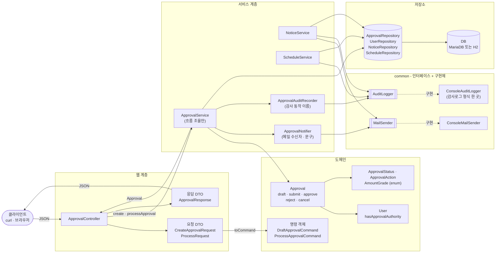
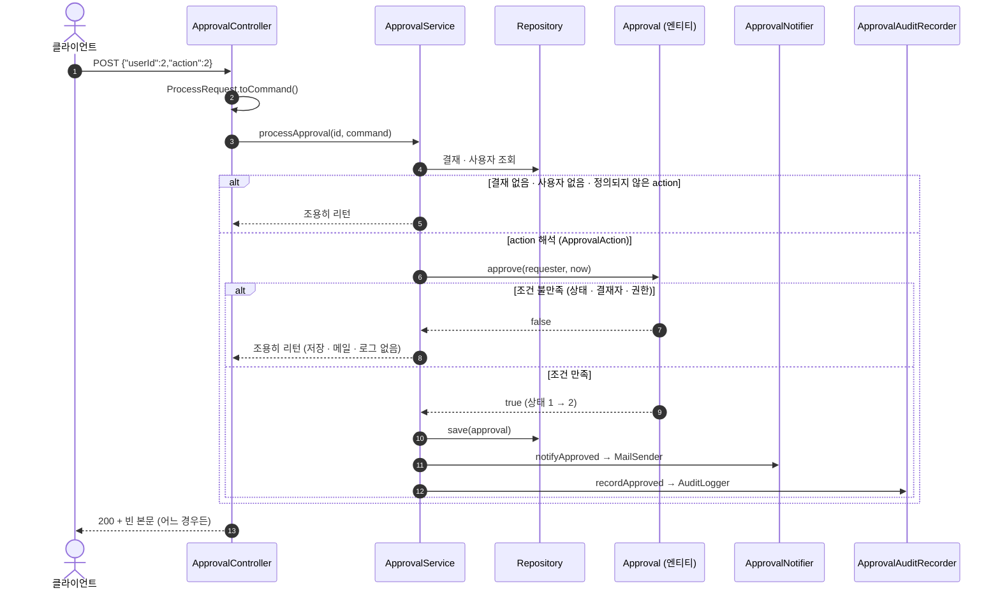
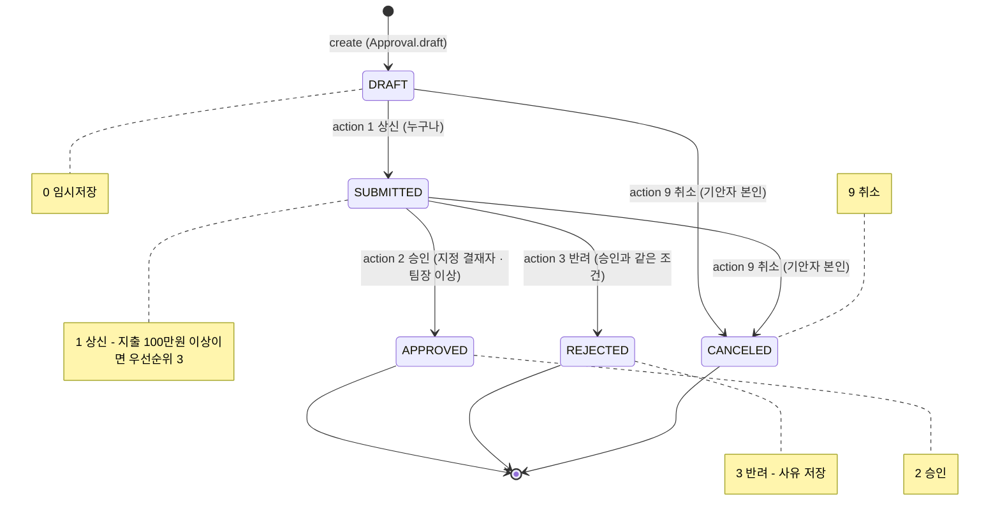
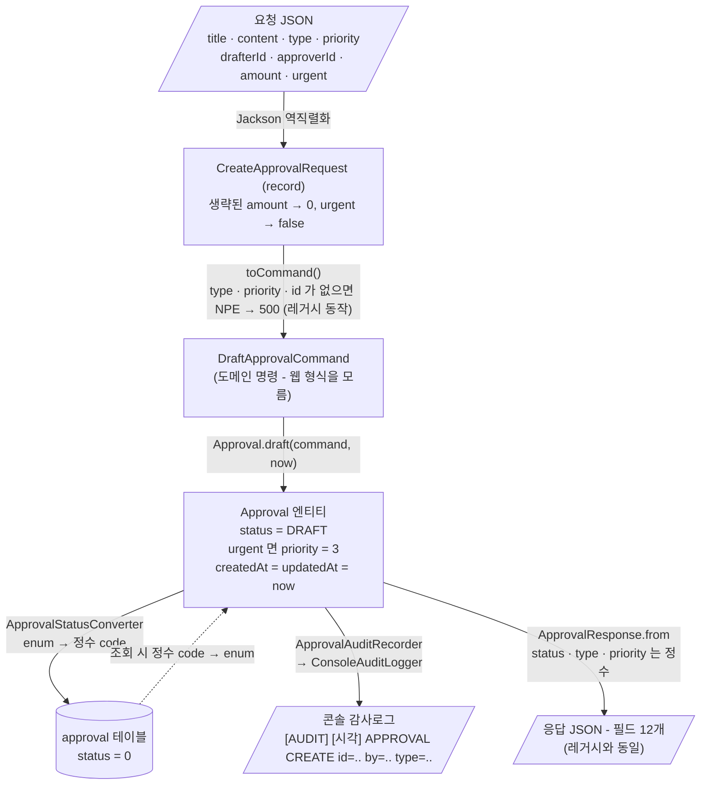
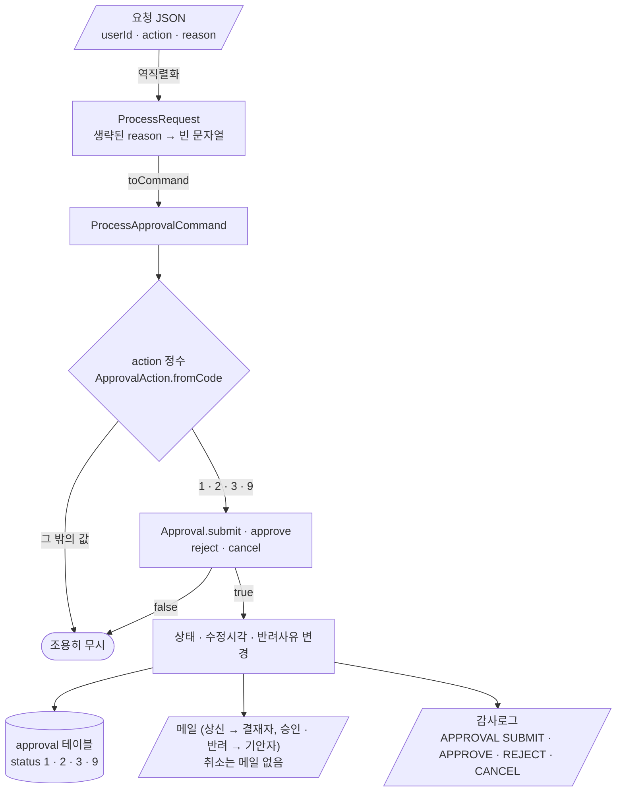
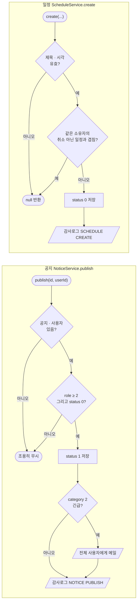

# 사내 업무 포털 (Legacy) - 클린코드 & 리팩토링 실습 코드

「클린코드 & 리팩토링 실전」 2일 과정의 **관통 실습 코드베이스**입니다.
결재 / 공지 / 일정 세 도메인을 가진 Spring Boot 애플리케이션이며,
**의도적으로 나쁜 코드(코드 스멜)** 를 심어 두었습니다. 2일 동안 Claude Code로 이 코드를
단계적으로 리팩토링합니다.

## 기술 스택
- Java 21 / Spring Boot 3.2 / Spring Data JPA / JUnit 5
- 실행 DB = MariaDB(localhost:3306, db=portal) · 테스트 = H2 인메모리 자동

## 사전 준비
- JDK 21 이상
- Maven 설치 불필요 - 프로젝트의 **Maven Wrapper(mvnw)** 가 자동 처리
- MariaDB (Windows=WSL Ubuntu / Mac=Homebrew, 계정 portal) - 선택. 비밀번호는 소스에 없고 환경변수 `PORTAL_DATASOURCE_PASSWORD` 로 넣는다 (REQ-SE-001)
- Claude Code CLI + Anthropic API Key

## 실행 (Maven 설치 불필요)
```bat
:: 그냥 실행하면 DB 를 자동 선택한다 (DataSourceConfig.java)
::   - MariaDB 가 떠 있고 PORTAL_DATASOURCE_PASSWORD 가 있으면 → MariaDB 사용
::     (URL · 계정도 PORTAL_DATASOURCE_URL · PORTAL_DATASOURCE_USERNAME 으로 바꿀 수 있다)
::   - MariaDB 가 없으면     → H2 인메모리로 자동 실행 (설치 0, 입력도 0)
.\mvnw.cmd spring-boot:run
```
- 시작 로그에 `>> DB = MariaDB` 또는 `>> ... → H2` 가 찍혀 어느 DB 인지 바로 보인다.
- H2 로 떴을 때 데이터 조회: http://localhost:8080/h2-console (JDBC URL: jdbc:h2:mem:portal, 사용자 sa)
- 테스트: `.\mvnw.cmd test` (H2 인메모리 자동)

## 빠른 동작 확인 (예: 결재 상신)
```bash
# 1) 결재 생성 (기안자=1 김사원, 결재자=2 박팀장, 지출 120만원)
#    Windows Git Bash 는 한글 JSON 이 깨져 400 이 나므로 예시 값은 영문
curl -X POST localhost:8080/api/approvals -H "Content-Type: application/json" \
  -d '{"title":"Laptop","content":"for dev","type":1,"priority":2,"drafterId":1,"approverId":2,"amount":1200000}'

# 2) 상신 (action=1)
curl -X POST localhost:8080/api/approvals/1/process -H "Content-Type: application/json" \
  -d '{"userId":1,"action":1}'

# 3) 승인 (action=2, 박팀장)
curl -X POST localhost:8080/api/approvals/1/process -H "Content-Type: application/json" \
  -d '{"userId":2,"action":2}'
```

## 구조와 흐름 (리팩토링 후 현재 코드 기준)

> 아래 도식은 GitHub 에서 Mermaid 로 렌더링됩니다. 레거시 → 현재로 무엇이 바뀌었는지는 각 클래스 상단 `[리팩토링]` 주석과 `docs/진단/` 문서를 참고하세요.

### 1. 전체 플로우 - 계층과 협력 객체

컨트롤러는 요청 DTO 를 도메인 명령으로 바꿔 넘기고(R12), 서비스는 흐름만 조율하며, 규칙은 엔티티가, 메일 · 감사로그는 인터페이스 뒤의 구현체가 맡습니다.



### 2. 결재 처리 순서 - `POST /api/approvals/{id}/process`

조건이 안 맞으면 엔티티가 `false` 를 돌려주고 서비스는 **아무것도 하지 않고 끝냅니다**(레거시의 "조용히 무시" 보존). 성공했을 때만 저장 → 메일 → 감사로그 순으로 부수효과가 일어납니다.



### 3. 결재 상태 전이 - DB 저장값 0/1/2/3/9



화살표에 없는 전이(예: 승인된 결재 취소, 사원의 승인)는 예외 없이 무시됩니다.

### 4. 데이터 플로우차트 - 결재 생성 요청의 데이터가 어떻게 바뀌어 흘러가는가



처리(상신 · 승인 · 반려 · 취소) 요청의 데이터 흐름:



### 5. 공지 · 일정 흐름 (요약)



## 초기 사용자
| id | 이름 | role | 의미 |
|----|------|------|------|
| 1 | 김사원 | 1 | 사원 |
| 2 | 박팀장 | 2 | 팀장 |
| 3 | 이임원 | 3 | 임원 |
| 4 | 최사원 | 1 | 사원 |

## 의도적으로 심어둔 코드 스멜 (요약)
| 위치 | 스멜 |
|------|------|
| `ApprovalService` | God Class, Long Method(`processApproval`), Magic Number, Tight Coupling, Feature Envy |
| `Approval`/`Notice`/`Schedule` | Anemic Domain Model, Primitive Obsession, 캡슐화 부재 |
| `NoticeService`/`ScheduleService` | 메일/감사로그 **중복 코드** |
| 전체 | 테스트 0개 (리팩토링 안전망 부재) |
| `ApprovalController` | 요청 DTO 부재, 매직넘버 action 노출 |

> 리팩토링 규칙과 개선 방향(매직넘버→enum · 직접 `new`→생성자 주입(DIP) · God 분해 · DTO 분리 · Rich Domain)은
> 이 저장소의 **`CLAUDE.md`** 를 참고하세요. 특히 **불변 규칙**(API·DB값·동작 보존)과 **특성화 테스트 절대 불변 규칙**이 핵심입니다.
> 단계별 실습 프롬프트는 강의 교재(Day1/Day2 PPT)를 따릅니다.
